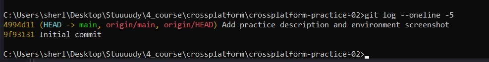

# Задание 2. Подготовка рабочего окружения

## Проверка инструментов

Работа выполнялась на компьютере под управлением Windows 10
с использованием локально установленных инструментов.

В командной строке были выполнены команды:

- git --version;
- node --version;
- npm --version;
- code --version.

Получены следующие версии:

| Инструмент | Версия |
|---|---|
| Git | 2.56.0.windows.2 |
| Node.js | 24.16.0 |
| npm | 11.13.0 |
| Visual Studio Code | 1.141.0, x64 |

Node.js относится к ветке 24 LTS.

## Создание и клонирование репозитория

На GitHub создан публичный репозиторий crossplatform-practice-02.

https://github.com/burning-helen/crossplatform-practice-02

Репозиторий клонирован на локальный компьютер командой git clone
и открыт в Visual Studio Code.

В README.md указаны тема работы, ФИО обучающегося, группа
и индивидуальный вариант.

## Фиксация и отправка изменений

После редактирования README.md и добавления скриншота окружения
изменения включены в локальный коммит и отправлены на GitHub.

Использованные команды:

git add README.md report/
git commit -m "Add practice description and environment screenshot"
git push

Для просмотра истории использована команда:

git log --oneline -5

## Результат

Рабочее окружение подготовлено. Создан удалённый репозиторий
и его локальная копия. Выполнены локальный коммит и отправка
изменений на GitHub. Подтверждающие скриншоты сохранены
для включения в итоговый отчёт.